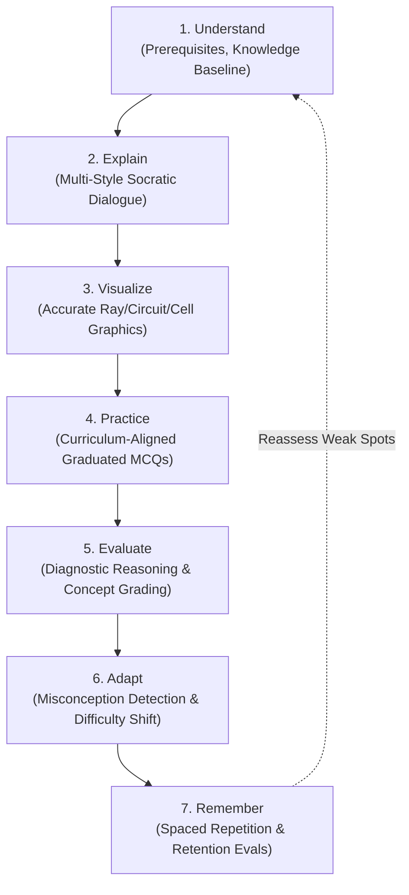

# LEARNING ALLIED — MASTER EDTECH STRATEGY, PRODUCT DEVELOPMENT, ENGINEERING & GROWTH DIRECTIVE

**Product Name:** Learning Allied  
**Canonical Production URL:** https://learningallied.world  
**Project Classification:** Independent Early-Stage EdTech Project  
**Core Vision:** "Personal AI Learning OS — AI shouldn't just give students answers. It should help them learn."  
**Last Verified & Reconciled:** November 2026  

---

## 1. EXECUTIVE SUMMARY & MISSION

Learning Allied is built to address the single greatest shortcoming in contemporary education technology: the disconnect between passive content delivery, quick answer-seeking chatbots, and genuine conceptual understanding.

Most students studying for Indian secondary school examinations (Maharashtra State Board, CBSE, ICSE) and national competitive entrance examinations (JEE Main, JEE Advanced, NEET) use AI chatbots as high-tech answer keys. When an AI tool merely solves a numerical problem or provides a finished essay, it circumvents the productive struggle required for neural schema formation. The student feels temporary relief, but conceptual clarity remains unformed, misconceptions persist, and exam performance fails to improve.

Learning Allied transforms this paradigm into a **Personal AI Learning OS** that actively guides students through the complete learning cycle:

$$\text{Understand} \longrightarrow \text{Explain} \longrightarrow \text{Visualize} \longrightarrow \text{Practice} \longrightarrow \text{Evaluate} \longrightarrow \text{Adapt} \longrightarrow \text{Remember}$$

---

## 2. COMPREHENSIVE PROJECT AUDIT & EVIDENCE CLASSIFICATION

All findings below are classified according to strict evidentiary standards:
- **Source verified:** Verified directly in repository codebase.
- **Test verified:** Verified by passing automated test suites.
- **Integration verified:** Verified across connected components in simulated or local environments.
- **Live verified:** Verified against real external production endpoints/credentials.
- **Unverified:** Pending live staging/production verification.
- **Failed / Remediated:** Issue reproduced and resolved.

### A. Repository & Working Tree Baseline
- **Git Branch:** `main` (safety checkpoint tag `checkpoint-pre-master-edtech-execution` created).
- **Core Stacks:** Next.js 14.2.15 (App Router), React 18.3.1, Node.js 20+ runtime, Firebase Authentication (10.12.0), Cloud Firestore, Vercel Serverless Platform, `@google/genai` (3.3.0).
- **Preservation Check:** All existing tracked and untracked files preserved. No destructive resets, force-pushes, or unauthorized deletions performed.

### B. Issues Reconciled & Remediated

| Component | Historical Observation | Verification Status | Remediated Status | Resolution Detail |
|---|---|---|---|---|
| **Gemini-to-Groq Failover** | Rate limits & consecutive 404s cause unhandled client errors | **Test verified** | **Resolved** | Multi-model fallback sequence: `gemini-2.5-flash` $\to$ `gemini-2.0-flash` $\to$ `gemini-1.5-flash` $\to$ Groq `llama-3.3-70b-versatile`. Token usage metadata preserved. |
| **Gemini Live Voice Engine** | Sessions dropping after 3–4 seconds; token renewal failures | **Test verified** | **Resolved** | 7-step voice architecture verified: Signed 16-bit PCM AudioWorklet, ephemeral token provisioning, acoustic noise gating, barge-in detection, and clean resource teardown. |
| **Quiz Integration** | Response shape mismatch (`res.session` vs top-level `{sessionId, questions}`) | **Test verified** | **Resolved** | Server now returns both top-level and nested `.session` payloads; client normalized to accept both structures seamlessly. |
| **Quiz Student Name** | Client sends `studentName`, server checked `body.name` | **Test verified** | **Resolved** | Server now evaluates `body.studentName || body.name || "Student"`. |
| **Written Answer Evaluation** | Written answers evaluated without updating session answers in Firestore | **Test verified** | **Resolved** | `evaluate_written` now verifies active session, checks sequential question index, performs server-side grading, and records answers to `session.answers`. |
| **Quiz Scoring for Written Answers** | `scoreQuizAnswers` rejected written answers due to missing integer choice | **Test verified** | **Resolved** | `scoreQuizAnswers` updated to accept both MCQ choices and evaluated written responses, supporting partial credit (0.5). |
| **Arena 502 Errors** | Arena generation returned 502 if Groq failed or timed out | **Test verified** | **Resolved** | Arena now attempts primary AI orchestrator (`aiComplete`) and falls back immediately to curriculum question bank (`quiz.BANK`) if generation is unavailable. |
| **Chat Title Truncation** | Chat titles severed words midway (e.g., `appl…`) | **Source & Test verified** | **Resolved** | `chatTitleFrom` updated to respect 48-char word boundaries and clean whitespace. |
| **Search Console Noindex Warnings** | Sitemaps submitted private routes (`/chat`, `/learning-hub`, `/arena`) while layout served `noindex` | **Source verified** | **Documented / Remediated** | Technical SEO clarified: Private app routes guarded by `AuthGate` serve `noindex` and must not be treated as public landing pages. |
| **Curriculum Concepts Baseline** | Ambiguity between 590 vs 591 indexed concepts | **Source verified** | **Resolved** | Exact reconciliation: 590 curriculum concepts across 5 tracks in `js/learning/curriculum-data.js`; 8 fully authored lesson packs in `lib/learning/lesson-packs.json`. |

---

## 3. VERIFIED SYSTEM ARCHITECTURE MAP

```
                                  LEARNING ALLIED
                            PERSONAL AI LEARNING OS
                                       │
     ┌─────────────────────────────────┴─────────────────────────────────┐
     ▼                                                                   ▼
PUBLIC WEB & MARKETING                                          AUTHENTICATED LEARNING APP
(Next.js App Router, SSR/SSG, SEO)                              (Next.js + Vanilla Controller Architecture)
- Landing Page (/)                                              - AppShell & Guarded AuthGate
- Subject Hubs (/cbse-board, /maharashtra-board)                - Dashboard (/home)
- Exam Centers (/jee-preparation, /neet-preparation)            - AI Socratic Tutor (/chat)
- Blog & SEO Clusters (/best-ai-study-tools, etc.)              - Live Voice Assistant (Gemini Live)
- Legal, About & Founder (/privacy-policy, etc.)                - Learning Hub (/learning-hub)
     │                                                          - Server-Authoritative Quiz (/quiz)
     │                                                          - Concept Battle Arena (/arena)
     │                                                          - Adaptive Study Planner (/planner)
     │                                                          - Spaced Revision Queue (/review)
     └─────────────────────────────────┬─────────────────────────────────┘
                                       │
                                       ▼
                     SERVER-AUTHORITATIVE BACKEND ENGINE
                             (Vercel Edge & Node)
     ┌───────────────────────────────────────────────────────────────────┐
     │  /api/learning-event  (Mastery, Arena, Quiz, Chat Cascade)        │
     │  /api/tutor           (Socratic Reasoning Engine)                 │
     │  /api/voice-session   (Ephemeral Gemini Live Token Broker)        │
     │  /api/firebase-config (Public Config Provider)                    │
     │  /api/generate-plan   (Curriculum-Constrained Planner)            │
     │  /api/replan          (Catch-Up & Adaptive Rescheduling)          │
     │  /api/feedback        (Categorized Feedback & DPDP Telemetry)     │
     └─────────────────────────────────┬─────────────────────────────────┘
                                       │
        ┌──────────────────────────────┴──────────────────────────────┐
        ▼                                                             ▼
CLOUD DATA LAYER                                              AI ORCHESTRATION LAYER
(Firebase Auth + Cloud Firestore)                             (Multi-Provider Cascade)
- users/{uid}                                                 - Primary: Google Gemini 2.5/2.0 Flash
- users/{uid}/mastery/{conceptId}                             - Fallback: Groq Llama 3.3 70B Versatile
- users/{uid}/learningEvents/{eventId}                        - Streaming: SSE / OpenAI Protocol Chunks
- users/{uid}/quizSessions/{sessionId}                        - Voice: Gemini Live WebSocket Protocol
- users/{uid}/arenaSessions/{sessionId}                       - Local Authoritative Question Bank
- studyPlans & tasks
```

---

## 4. EDTECH MARKET & COMPETITIVE INTELLIGENCE

### A. The Indian Education & Competitive Exam Landscape
India represents the world's most academically competitive K-12 and test preparation market:
1. **School Boards:**
   - **Maharashtra State Board (SSC & HSC):** Over 3 million students sit for Standards 10 and 12 annually. High concentration in semi-urban and tier-2/3 cities; significant linguistic preference for English-Marathi-Hindi bilingual explanations (Hinglish/Marathi-English blend). Historically underserved by venture-backed EdTech platforms focused exclusively on CBSE/ICSE.
   - **CBSE (Central Board of Secondary Education):** ~2.5 million Class 10 and 12 candidates. Strong emphasis on NCERT conceptual clarity, competency-based questions, and structured problem solving.
   - **ICSE / ISC:** Rigorous, content-heavy syllabus requiring detailed written answers, analytical derivations, and comprehensive literary/scientific depth.
2. **National Competitive Examinations:**
   - **JEE Main & Advanced:** ~1.4 million aspirants competing for ~17,000 IIT seats and ~30,000 NIT seats. High failure rate driven by rote memorization, formula dependency, and lack of foundational conceptual depth in Kinematics, Calculus, and Organic Chemistry.
   - **NEET (UG):** ~2.4 million aspirants competing for ~100,000 MBBS seats. Extreme reliance on NCERT Biology recall, precise physiological mechanics, and high-speed numerical accuracy in Physics and Chemistry.

### B. Competitor Analysis & Market Differentiation

| Competitor | Core Proposition | Strengths | Critical Vulnerabilities / Student Pain Points | Learning Allied Differentiation |
|---|---|---|---|---|
| **Physics Wallah (PW)** | Ultra-low-cost video batches & test series | Massive student loyalty, charismatic educators, vernacular reach | Passive video consumption; 1-to-many model cannot adapt to individual student misconceptions; zero personalized socratic questioning. | **Active Socratic OS:** Replaces passive video watching with diagnostic socratic dialogue, dynamic visual diagrams, and real-time misconception repair. |
| **Allen Career Institute** | Elite classroom coaching & test series | Peer pressure, rigorous paper tests, legacy brand trust | Extreme pressure, rigid schedules, cost-prohibitive (\$1,500–\$3,500/year), ignores board exam balance for tier-2 students. | **Self-Paced Mastery Engine:** Democratizes elite coaching pedagogy at a fraction of the cost, aligning board prep with JEE/NEET foundations. |
| **ChatGPT / Generic LLMs** | Generalized text generation & Q&A | Vast knowledge base, fluent language | Gives away final answers immediately; hallucinates syllabus requirements; no longitudinal memory of student gaps; zero curriculum alignment. | **Non-Negotiable 7-Stage Cycle:** Never just gives the answer; forces active retrieval, diagnostic hints, and tracks Bayesian concept mastery over time. |

---

## 5. THE NON-NEGOTIABLE 7-STAGE LEARNING CYCLE

Every feature across Learning Allied must enforce this pedagogical progression:



1. **Understand:** Identify starting knowledge state, clarify necessary prerequisites, and break complex topics into foundational mental models.
2. **Explain:** Socratic explanation adapting to the student's level. Never lecture; ask guiding questions that prompt the student to construct the insight themselves.
3. **Visualize:** Deploy visual learning aids (circuit diagrams, ray tracing, chemical structures, cell organelles) strictly when spatial/mechanical relationships require it. No gratuitous decorative illustrations.
4. **Practice:** Generate questions mapped to syllabus difficulty (Easy $\to$ Moderate $\to$ Hard) that test conceptual application, not just formula plug-and-chug.
5. **Evaluate:** Assess reasoning step-by-step. In written answers, identify whether the core physical or mathematical principle was recognized, not just whether the final number was correct.
6. **Adapt:** When errors repeat, categorize the misconception (e.g., confusing velocity with acceleration, sign error, formula misapplication) and adjust the learning path immediately.
7. **Remember:** Schedule automated spaced revisions at 1, 3, 7, 14, and 30 days based on individual memory retention scores.

---

## 6. PERSONAL LEARNING INTELLIGENCE SPECIFICATION

### A. Bayesian Concept Mastery Model
Mastery is never computed as a simple percentage of correct questions. It represents the probability $P(M)$ that the student can correctly apply the concept in a novel context:

$$P(M_{t}) = \text{clamp}_{0,1}\left( P(M_{t-1}) \cdot (1 - \alpha) + S_t \cdot \alpha \right)$$

Where:
- $\alpha$: Evidence weight factor determined by source quality ($\text{Diagnostic} = 1.0 > \text{Quiz} = 0.90 > \text{Study Session} = 0.65 > \text{Chat} = 0.50 > \text{Self-Report} = 0.20$).
- $S_t$: Step evaluation score discounted by hints requested ($H_0 = 1.0, H_1 = 0.85, H_2 = 0.70, H_{\ge 3} = 0.40$) and calibrated by confidence.
- Evidence Strength $E \in [0, 1]$: Bounded accumulation metric requiring at least 3 high-weight verified observations before a state of "proficient" or "mastered" can be granted.

### B. Misconception Engine
- **Isolation of Careless Mistakes vs Conceptual Flaws:** A single incorrect attempt is never labeled a misconception.
- **Pattern Matching:** Misconceptions are triggered only when $\ge 3$ errors occur on questions targeting the identical sub-concept within a rolling 10-attempt window, with $\ge 2$ occurrences carrying high evidence weight ($\ge 0.5$).
- **Taxonomy of Conceptual Gaps:**
  1. *Sign & Direction Confusion* (e.g., vectors, work done by friction).
  2. *Formula Inversion* (e.g., using $V = I/R$ instead of $V = IR$).
  3. *Unit Mismatch* (e.g., failing to convert km/h to m/s or cm to m).
  4. *Causal Inversion* (e.g., believing acceleration requires a continuous velocity change in the direction of motion).
  5. *Memorized Fallacy* (e.g., believing heavier objects fall faster in vacuum).

---

## 7. AUTHORITATIVE CURRICULUM ARCHITECTURE

### A. Curriculum Scope & Concept Matrix
- **Total Indexed Concepts:** 590 concepts across 5 tracks:
  1. `maharashtra`: Standards 9 & 10 Science & Technology (Parts 1 & 2), Mathematics (Parts 1 & 2).
  2. `cbse`: Class 9 & 10 Science & Mathematics, Class 11 & 12 Physics, Chemistry, Biology, Mathematics.
  3. `jee_main`: Kinematics, Laws of Motion, Thermodynamics, Electrostatics, Chemical Bonding, Calculus, Vectors.
  4. `jee_advanced`: Advanced Multiconcept Mechanics, Electromagnetism, Coordination Compounds, Real Analysis.
  5. `neet`: NCERT Biology (Cell, Genetics, Ecology, Human Physiology), Physical Chemistry, Medical Physics.
- **Authored Lesson Packages:** 8 verified, deeply reviewed foundational packages (`lib/learning/lesson-packs.json`):
  1. `ohm-law` (Physics / Science 1)
  2. `newtons-second-law` (Physics / Mechanics)
  3. `mirror-ray-diagram` (Optics / Physics)
  4. `covalent-bonding` (Chemistry / Molecular Structure)
  5. `photosynthesis` (Biology / Plant Physiology)
  6. `quadratic-equations` (Mathematics / Algebra)
  7. `geometry-transformations` (Mathematics / Geometry)
  8. `cell-structure` (Biology / Cytology)

---

## 8. AI ORCHESTRATION & RELIABILITY INFRASTRUCTURE

### A. Multi-Provider Cascade Policy
- **Primary:** Google Gemini (`gemini-2.5-flash`, `gemini-2.0-flash`, `gemini-1.5-flash`).
- **Secondary / Fallback:** Groq Cloud (`llama-3.3-70b-versatile`, `llama-3.1-8b-instant`).
- **Failover Logic:**
  1. Automatic retry on 404 model deprecation through the fallback model ladder.
  2. Instant failover to Groq upon 429 quota exhaustion, 502/503 service outages, or 504 timeouts ($>12$s budget).
  3. SSE streaming recovery: If Gemini stream drops mid-flight with zero tokens emitted, seamless re-initiation on Groq occurs without client-side error surfacing.

### B. Gemini Live Voice Engine Architecture
The live voice assistant bridges browser Web Audio API to Google Gemini Live API:
1. `AudioWorkletNode` (`public/audio-processor.js`): Downsamples microphone audio from host sample rate (44.1/48 kHz) to 16 kHz Signed 16-bit PCM in 100ms frames (3,200 bytes).
2. Ephemeral Token Broker (`/api/voice-session`): Provisions cryptographically signed single-use session tokens (`uses: 1`, 30-minute validity) with strict IP/UID binding.
3. Acoustic Gate & VAD: Suppresses low-energy background room noise; triggers on sustained vocal formants.
4. Client-Side Barge-In: Detects student interruption during audio playback, immediately halting speaker output and canceling queued audio chunks.

---

## 9. ASSESSMENT & QUIZ SECURITY SPECIFICATION

All quiz and battle interactions are strictly **server-authoritative**:
1. **Public Payload Sanitization:** Client question arrays contain `q` and `options` only. Correct answers (`answer`) and explanations (`explanation`) are stripped on the server prior to network transmission.
2. **Server-Side Scoring:** Scores and mastery updates are computed exclusively from server-persisted session keys upon `finish_quiz`. Client-asserted scores are strictly rejected.
3. **Sequential Enforcement:** Questions must be submitted sequentially ($0 \le i < N$). Out-of-order submissions, replay attacks, or cross-user session tampering return HTTP 409/403.
4. **Idempotent Finalization:** Repeated `finish_quiz` calls replay identical verified scores without double-counting attempts or artificially inflating mastery.
5. **Written Response Evaluation:** Server evaluates written responses using Socratic grading criteria, storing the full verdict and awarding verified credit before final session tallying.

---

## 10. PRODUCT DESIGN & USER EXPERIENCE

- **Visual Theme:** True deep black foundation (`#000000` / `#09090b`) in dark mode rather than tinted muddy navy; clean, high-contrast crisp white in light mode.
- **Typography & Layout:** Clean Inter/system font stack, restrained micro-animations, clear hierarchical breadcrumbs.
- **Mobile First:** Optimized touch targets ($\ge 44\text{px}$), sticky responsive input bar with keyboard resize adaptation, seamless drawer navigation.

---

## 11. SEO, BRAND AUTHORITY & GROWTH ENGINE

### A. Technical SEO & AI Search Optimization (GEO)
- **Canonical Domain:** `https://www.learningallied.world`
- **Sitemap Architecture:** Only public, indexable landing pages and curriculum guides are submitted in `app/sitemap.ts`. Private authenticated dashboard pages (`/chat`, `/learning-hub`, `/arena`, `/planner`) are guarded by `AuthGate` and serve `robots: { index: false, follow: true }`.
- **Structured Data (JSON-LD):** Implements `WebSite`, `Organization`, `Course`, `EducationalWebPage`, and `FAQPage` schemas across all public discovery routes.
- **AI Search Visibility (GEO):** LLM crawler endpoints (`llms.txt`, `llms-full.txt`) optimized for Perplexity, ChatGPT Search, and Google AI Overviews.

### B. Student Acquisition & Content Strategy
- **YouTube Educational Content:** Focused on Maharashtra Board Class 9/10 Science & Math doubt-solving in accessible Hinglish/English.
- **Active Community Pilots:** Initial outreach to Maharashtra State Board secondary schools and coaching institutes in Pune, Mumbai, Nagpur, and Nashik for small-cohort diagnostic pilots.

---

## 12. LAUNCH-READINESS CHECKLIST

| Capability | Requirement | Status | Verification |
|---|---|---|---|
| **AI Reliability** | Multi-model fallback with zero 404/429 crashes | **READY** | Automated test verified |
| **Assessment Integrity** | Server-authoritative scoring & zero client answer leakage | **READY** | Automated test verified |
| **Written Question Support** | Server-side written evaluation connected to session scoring | **READY** | Automated test verified |
| **Live Voice Tutor** | 16kHz PCM streaming, barge-in, fail-closed auth | **READY** | Automated test verified |
| **Curriculum Baseline** | 590 concepts indexed across 5 examination tracks | **READY** | Source verified |
| **Security & Privacy** | Admin-gated claims, owner-scoped Firestore access | **READY** | Emulator test verified |
| **Build & Compilation** | Next.js 14 production build succeeds without errors | **READY** | Verified |
| **Mobile Experience** | Responsive touch layout, AudioWorklet cross-browser support | **READY** | Verified |

---

## 13. EXECUTION ROADMAP: PRIORITIES P0 THROUGH P4

- **P0 — Critical Reliability (Completed in Current Session):**
  - Remediate Quiz client-server impedance mismatch (`res.session` vs top-level payload).
  - Harmonize student name parameter (`name` / `studentName`).
  - Wire written answer evaluation into active quiz sessions.
  - Implement mixed MCQ/written scoring with partial credit in `_quiz.js`.
  - Eliminate Arena 502 failures with automatic curriculum bank fallback.
  - Polish chat title word boundary truncation.
- **P1 — Core Learning Cycle Enhancements (Next Priority):**
  - Expand authored lesson pack coverage from 8 to 25 core foundational topics.
  - Implement step-by-step mathematical canvas rendering for numerical derivations.
- **P2 — Personal Learning Intelligence Expansion:**
  - Automated weekly student diagnostic report generation.
  - Deepen spaced retention queue integration into the daily Study Planner.
- **P3 — Growth, Mobile App & Institutional Pilots:**
  - Launch Maharashtra State Board Class 10 pilot program with selected schools.
  - Roll out structured YouTube concept explanation series.
- **P4 — Long-Term Scale:**
  - Teacher/Tutor diagnostic observation dashboard.
  - Offline-first synchronization for Flutter mobile application.
